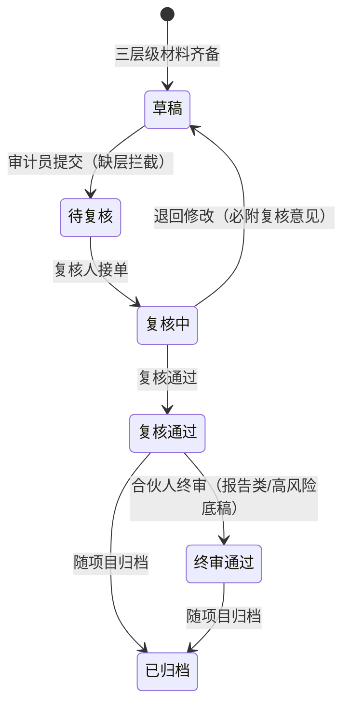
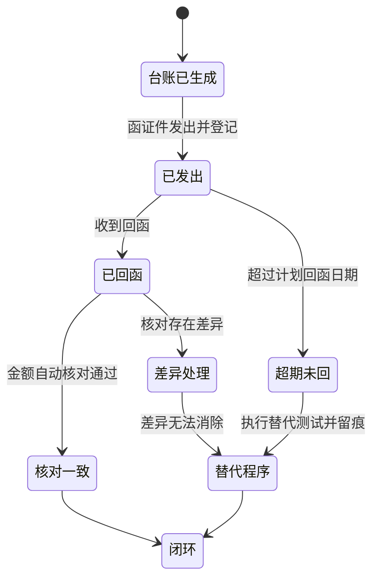
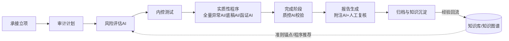

# Echo——中小事务所智能审计作业系统产品需求文档（PRD）v1.2

> 产品名：Echo ｜ 产品形态：本地化智能审计作业系统（Skill 家族 + AI 赋能层）
> 版本：v1.2 ｜ 2026-10-27 ｜ 依据：《Aura-CN 本土化 AI 赋能设计方案》×《AI 在审计工作中的应用实践分享》方法论提炼
> 本版修订说明：v1.1 新增「核心对象与状态」「共享规则」等章并补全行为链、修正不一致口径；v1.2 将原开放问题清单 17 项全部敲定为决策记录（§15），并同步落实至正文相关条款。功能范围、合规约束与三期路线与 v1.0 保持一致。

## 一、产品背景与目标

### 1.1 背景与问题

**中小所痛点（产品要解决的问题）**

- 工时约束下无法执行全量审计程序，程序执行缺口依赖人工经验判断，难以自证；
- 质控力量薄弱，复核留痕不全，应对监管检查成本高；
- 人才培养慢，资料整理、分类归档、底稿初稿等重复性基础工作占据大量工时；
- 市面审计软件"面上好看不解决实际问题"，事务所沦为软件厂商的 OEM。

**内部判断**（行业窗口期，属团队判断，非经第三方验证）：AI 处于审计行业渗透早期，大型机构正以万份级报告反向总结行业经验；行业尚未被充分覆盖，先完成知识沉淀、先让团队会用 AI 的事务所将建立壁垒。未来竞争点只有两条：知识沉淀情况、有多少人会用人。

**监管与合规要求（产品必须满足的事实约束）**

| 依据 | 要求 | 产品响应 |
| --- | --- | --- |
| CSA 1301（审计证据）修订 | AI 输出仅为线索（lead），经人工复核后方可作为审计证据归档 | 人工复核标记规则（§7 R2） |
| 质量管理准则 5101/5102 | AI 工具须纳入质量管理体系 | ITC 定期评估（§8 NFS-05）、合规红线 §11 |
| 财政部 2024 年数据分级文件及 2026 年文件 | 数据按核心/重要/一般三级管控；严禁将审计信息输入公共平台 | 数据不出域规则（§7 R4） |

### 1.2 产品定位

以八阶段风险导向审计框架为过程框架，以中国注册会计师审计准则体系为程序依据，以 AI 为执行赋能层，面向中小事务所高频审计业务。方法论骨架为本所自有提炼，执行去品牌化决策（§15-1）：产品对外表述不含外部机构来源，知识库不内置外部机构受版权内容。两个差异化支点：

- **方法论下放**：风险导向审计引擎按国际通行风险导向方法论框架自主实现，中小所以中小所价格获得同等过程骨架；
- **AI 全量测试**：对 100% 凭证与银行流水进行异常评分，覆盖面超出 CSA 1313 对会计分录测试的要求。

### 1.3 产品目标（可观测口径）

| 目标 | 可观测口径 | 度量方式 |
| --- | --- | --- |
| 效率 | 资料整理、分类归档、底稿初稿等重复性工作的项目工时压缩 50% 以上；10 年份量级历史底稿资料分析由数周压缩至 2 小时量级 | 以近两年已完结、同行业模板、同规模档位的项目工时底稿为基线池（不少于 3 个项目取中位数）（§15-2） |
| 质量 | 每张底稿可反查准则锚点（准则号+条款+程序目的）；交叉索引自动校验；AI 使用过程 100% 留痕；归档包通过质控完整性检查 | 质控 AI 检查报告 + 质控抽查 |
| 能力 | 审计人员工作重心回归业务实质判断；项目经理同时掌握经营实质分析与 AI 工具使用 | 半年度项目复盘会 + AI 使用问卷评估（§15-2） |
| 落地 | Phase 3 双项目（商洛鸿瑞怡园 2024 年报 + 鲲鹏物创 2025 底稿）完整归档通过 | 质控部门验收意见 |

### 1.4 设计原则

- **AI 是基层数字员工**：从"人要用 AI 做什么"出发，AI 只负责执行，结果由人确认，审计责任始终由签字会计师承担；
- **质控先行**：质控/质量标准部先行业务人员介入，AI 是风控体系的一部分；
- **简化不降质**：低风险账户启用简化程序包，但保留准则最低程序底线标注；高风险账户强制全程序（§7 R5）；
- **数据不出域**：客户数据绝不上公有云，AI 推理优先本地/私有化处理，敏感部分必须脱敏（§7 R4）；
- **模板即规则**：严格遵循事务所现有底稿模板体系，不自创格式。

## 二、目标用户与使用场景

| 角色 | 核心诉求 | 高频使用场景 | 关键功能触点 |
| --- | --- | --- | --- |
| 合伙人 | 全所项目管控、风险兜底、知识资产增值 | 查看项目进度与质控指标；审批报告签发与意见分歧；批准 Skill 升级与知识入库 | 项目面板（§5.1）、审批流（§5.5）、知识库管理（§5.7） |
| 项目经理 | 带队提效、复核减负、聚焦风险 | 确认 AI 风险清单与程序组合；复核底稿并双签；逐条处理 AI 归集的审计问题 | 风险评估 AI（§5.2）、复核工作台（§5.5）、问题清单（§5.3） |
| 审计员 | 摆脱重复劳动、快速产出规范底稿 | 资料包自动分类归档；三层级材料投喂生成底稿初稿；执行抽凭清单 | 底稿 AI（§5.3）、文档自动分类（§5.1）、全量异常抽凭（§5.3） |
| 质控专员 | 质控前置、留痕完整、检查可应对 | 运行完整性检查与程序缺口提示；核对 AI 使用留痕；管理质量档案 | 质控 AI（§5.6）、阶段门卡控（§7 R3）、归档模块（§5.6） |

**典型使用场景**

- **场景 A（审计员）**：项目开始前客户一次性提交资料包，系统自动分类、按 §7 R6 命名规则重命名归档并预解析入向量库；编制租赁负债底稿时按三层级材料投喂（客户基础材料/事务所审定表与底稿模板/填表说明），AI 生成初稿，审计员核对业务实质后提交复核。
- **场景 B（项目经理）**：打开项目面板查看阶段门状态与风险清单；对 AI 归集的每张底稿审计问题逐条判断处理；对全量异常 AI 输出的抽凭清单排序执行；复核审计员底稿并双签。
- **场景 C（合伙人）**：查看全所项目进度与质控指标；审批高风险事项（报告签发、意见分歧裁决、阶段门跳过双批）；决定知识库沉淀与 Skill 升级发布。
- **场景 D（质控专员）**：运行质控 AI 的底稿完整性检查与程序执行缺口提示；核对 AI 使用过程留痕链条；管理项目质量档案与检查应对材料。

## 三、系统角色与权限

| 权限项 | 合伙人 | 项目经理 | 审计员 | 质控专员 |
| --- | --- | --- | --- | --- |
| 项目立项/终止 | 审批 | 申请 | 无 | 建议 |
| 审计计划确认 | 审批 | 编制确认 | 无 | 查看 |
| 底稿编制 | 查看 | 编制/复核 | 编制 | 查看 |
| 底稿复核签发 | 终审 | 复核（非本人编制） | 无 | 质控复核 |
| AI 输出采信确认 | 审批 | 复核确认 | 提交待复核 | 抽查 |
| 问题清单处理 | 查看分歧项 | 确认与处理 | 反馈说明 | 抽查 |
| 报告签发 | 签发 | 草稿 | 无 | 会签 |
| Skill/模板发布 | 批准 | 提案 | 无 | 审核 |
| 知识库写入 | 批准（保留驳回权） | 提交（经审核） | 提案 | 直接写入（免自审）；审核他人提交（§15-3） |
| 项目归档与调阅 | 全所调阅 | 项目内 | 项目内只读 | 全所调阅 |

**职责分离与最小权限**

- 编制与复核不得为同一人（Preparer/Reviewer 双签，§7 R1）；
- AI 输出未经人工复核标记（复核人+日期）不得作为证据归档（§7 R2）；
- Skill 工具一次审核、发布后团队共用；无权限者不可调用未审核版本；
- **数字员工分层**（助理/经理/副经理/合伙人四级）描述的是 AI 承担的人类职级职责层级，不是系统账号角色；系统账号角色以上表四类为准。AI 仅承担基础执行层工作，其输出一律进入人工复核流程。映射关系：助理级对应审计员日常执行类任务（资料整理、初稿生成、抽凭清单执行辅助）；经理级对应项目经理复核辅助（完整性检查、缺口提示）；副经理/合伙人级 AI 不承担，仅提供汇总视图；AI 输出一律视同助理产出进入复核（§15-4）。

## 四、核心对象与状态

### 4.1 对象模型

| 对象 | 说明 | 关键属性 |
| --- | --- | --- |
| 项目 | 一次审计委托的全周期载体 | 项目编号、委托方、年份、行业模板、阶段门状态、团队与权限 |
| 底稿 | 最小作业单元，Excel 形态 | 底稿编号、准则锚点、状态、编制人/复核人、交叉索引、关联 AI 留痕 |
| 函证 | 独立函核对单元 | 函证编号、对方单位、金额、状态、回函结果、替代程序记录 |
| 问题 | AI 归集或人工登记的审计问题 | 问题编号、来源底稿、描述、状态、处理结论 |
| AI 留痕 | 一次 AI 调用的完整记录 | 字段见 4.6 |
| 知识条目 | 准则、经验、Skill 的沉淀单元 | 类型（准则/经验/Skill）、准则锚点、状态、入库审批记录 |

### 4.2 项目八阶段门与准入条件

系统沿用八阶段门过程管理（内部代号 Aura）。每个阶段门全部准入条件满足后方可流转，未通过锁定下一阶段；跳过须合伙人+质控双批并留痕（§7 R3）。

| # | 阶段门 | 准入条件 | 卡控责任 |
| --- | --- | --- | --- |
| 1 | 承接 | 业务承接评价通过（独立性检查、客户风险初评、胜任能力自评）；立项审批通过；项目编号已生成 | 合伙人审批 |
| 2 | 计划 | 总体审计策略与具体审计计划编制完成并经合伙人审批；团队与权限配置完成 | 合伙人审批 |
| 3 | 风险评估 | 风险评估 AI 已生成风险清单；项目经理确认风险评级与程序组合；程序包选择完成（§7 R5） | 项目经理确认 |
| 4 | 内控 | 内控了解与测试底稿完成；控制缺陷已关联风险清单 | 项目经理复核 |
| 5 | 实质性 | 全部计划底稿完成双签复核；函证全部闭环（回函核对一致或替代程序留痕）；问题清单全部处理或升级裁决 | 项目经理复核 + 质控抽查 |
| 6 | 完成 | 完成阶段底稿（期后事项、关联方、持续经营等）编制完成；质控 AI 完整性检查与交叉索引校验通过 | 质控专员 |
| 7 | 报告 | 附注草稿人工复核完成；报告审批流通过；合伙人签发 | 合伙人签发 + 质控会签 |
| 8 | 归档 | AI 留痕、复核痕迹、项目质量档案齐备；一键归档校验通过 | 质控专员 |

### 4.3 底稿状态机

状态规则：

- 复核通过前底稿不得参与阶段门流转，不得进入归档包；
- 退回修改必须附复核意见，修改后重新提交形成新的复核轮次，全部轮次留痕可追溯；
- 报告类与高风险底稿须经合伙人终审。重要底稿判定清单：审计报告与附注、总体策略与重要性水平底稿、风险评估总表、关键审计事项底稿、含调整分录的底稿、货币资金/收入/关联方底稿、意见分歧涉及的底稿（§15-11）；
- AI 生成内容在草稿态即须完成人工复核标记，未标记的底稿无法提交（§7 R2）。

### 4.4 函证状态机

- 发出后 30 天未回函自动转「超期未回」，此后每 15 天提醒一次，累计两次提醒后系统建议启动替代程序（§15-7）；
- 处于「差异处理」「替代程序」状态的函证不阻塞底稿编制，但阻塞实质性阶段门流转；
- 全部函证达到「闭环」是实质性阶段门的准入条件之一。

### 4.5 问题清单状态

已归集 → 已确认（项目经理判断是否成立）→ 处理中 → 已解决 → 已关闭（复核确认）。

- AI 归集的问题默认进入「已归集」；项目经理误报可标记「已排除」并留痕理由；
- 涉及报告意见类型的问题升级合伙人裁决（FR-05-05），裁决前不得关闭。

### 4.6 AI 使用留痕记录

每次 AI 调用生成一条留痕记录，字段固定如下：

| 字段 | 说明 |
| --- | --- |
| 留痕编号 | 系统自动生成，全局唯一 |
| 触发人 / 触发时间 | 发起 AI 调用的账号与时间戳 |
| 功能模块与版本 | 所调用的 Skill 名称与版本号 |
| 输入材料清单 | 本次调用使用的材料名称与来源索引 |
| 输出摘要与文件 | AI 输出内容摘要及生成文件索引 |
| 复核人 / 复核日期 | 人工复核标记（§7 R2），未标记则该记录对应输出不得归档 |
| 采信结论 | 采信 / 部分采信 / 不采信，附理由 |
| 关联对象 | 关联的底稿、函证或问题编号 |

## 五、核心功能需求

### 5.1 项目立项与承接（阶段门：承接）

| 编号 | 功能点 | 触发与权限 | 产品行为 | 结果与状态 | 优先级 |
| --- | --- | --- | --- | --- | --- |
| FR-01-01 | 业务承接评价 | 发起立项时，项目经理填写 | 在线完成独立性检查、客户风险初评、胜任能力自评；任一项未通过即拦截立项 | 评价通过后方可提交立项审批 | P0 |
| FR-01-02 | 立项建档 | 立项审批通过后自动执行 | 生成项目编号，自动初始化八阶段门（§4.2）、项目目录结构与团队权限 | 项目进入「承接门已通过」状态 | P0 |
| FR-01-03 | 文件命名引擎 | 资料入库时自动执行 | 按 §7 R6 规则（项目编号+委托方+年份+类别）自动重命名并归档全部资料 | 命名结果可追溯，重命名留痕 | P0 |
| FR-01-04 | 资料自动分类 | 资料上传后自动执行 | AI 按内容自动分类入决策档案等目录，并预解析入向量库备后续调用；分类结果由审计员确认 | 分类确认后资料可被后续模块引用 | P0 |
| FR-01-05 | 资料清单前置 | 立项后自动生成 | 按所选行业模板生成客户一次性资料清单；缺口实时提示，支持客户按清单一次性补齐 | 清单项与到料状态一一对应，缺口可见 | P0 |
| FR-01-06 | 合同与收费校验 | 立项录入合同时，项目经理 | 对照《业务收费管理办法》校验报价合规性并留痕 | 校验不通过阻断立项，提示差异项 | P1 |

### 5.2 审计计划与风险评估（阶段门：计划、风险评估）

| 编号 | 功能点 | 触发与权限 | 产品行为 | 结果与状态 | 优先级 |
| --- | --- | --- | --- | --- | --- |
| FR-02-01 | 总体策略与具体计划 | 进入计划门后，项目经理编制 | 按模板生成总体审计策略与具体审计计划，关联重要性水平（默认计算规则见 §7 R8） | 计划经合伙人审批后计划门通过 | P0 |
| FR-02-02 | 风险评估 AI | 项目经理发起 | 读入财报与明细账（.xlsx/.xls/.csv；最低字段要求与字段映射模板见 §15-6），生成风险清单并逐项映射认定层次、推荐程序组合，每项附准则锚点 | 输出为风险清单草稿（AI 留痕） | P0 |
| FR-02-03 | 风险评级确认 | 项目经理逐项确认 | 对 AI 风险清单逐项确认或修改评级；确认后按 §7 R5 触发程序包选择（高风险全程序/低风险简化程序包） | 评级确认后锁定，触发风险评估门流转 | P0 |
| FR-02-04 | 行业模板选择 | 立项或计划阶段选择 | 提供中小所高频模板矩阵：一般企业年报、小企业准则、事业单位、房地产、建安、商贸、科技型中小企业、非上市 | 模板选择决定资料清单与底稿模板范围 | P0 |
| FR-02-05 | 团队与工时 | 项目经理配置 | 项目人员配置与权限分配；工时预算与实际对比展示 | 工时偏差超 10% 时面板告警 | P1 |

风险评估 AI 行为链：输入（财报+明细账）→ 处理（读取→生成风险清单→映射认定层次→推荐程序组合）→ 输出（带准则锚点的风险清单草稿+AI 留痕）→ 人工（项目经理逐项确认/修改）→ 状态（确认后锁定并驱动程序包规则）。项目经理修改评级不限制项数，但每处修改记入留痕。

### 5.3 底稿编制（阶段门：实质性）

| 编号 | 功能点 | 触发与权限 | 产品行为 | 结果与状态 | 优先级 |
| --- | --- | --- | --- | --- | --- |
| FR-03-01 | 三层级材料投喂 | 审计员发起底稿编制 | 客户层/事务所层/填表说明三层材料分层登记与校验；任一层缺失即拦截并明确列出缺口清单，不出半成品 | 三层齐备后解锁底稿 AI 初稿 | P0 |
| FR-03-02 | 底稿 AI 初稿 | 三层齐备后，审计员触发 | 严格按现有模板生成：公式不改、下拉框不发挥，AI 按表头自行判断取数；无法可靠生成的单元格标注"AI 未能生成"并置空提示人工，不得编造 | 生成底稿草稿+AI 留痕，进入 §4.3 草稿态 | P0 |
| FR-03-03 | 准则锚点 | 底稿创建时自动带出 | 每张底稿内置准则号+条款+程序目的字段，由准则映射总表自动带出，人工可核对修正 | 锚点字段随底稿归档，支持反查 | P0 |
| FR-03-04 | 全量异常 AI | 审计员对凭证/流水发起 | 对 100% 凭证与银行流水计算异常评分，生成按风险降序的抽凭清单；默认抽取规则：评分 Top 10% ∪ 单科目评分最高 5 笔，且合计不少于 20 笔；项目经理可调整（下限 5%），调整留痕；评分版本号记入 AI 留痕（§15-8） | 审计员按清单执行并回填结果，执行记录留痕 | P0 |
| FR-03-05 | 交叉索引 | 底稿保存时自动执行 | 底稿间引用关系自动生成并校验，断链即提示 | 引用关系入归档包，断链清单可见 | P0 |
| FR-03-06 | 问题自动归集 | AI 编制/复核过程中识别 | 每张底稿的审计问题（如经营范围与实际销售不符）自动归集至问题清单（§4.5） | 问题进入「已归集」态待项目经理确认 | P1 |
| FR-03-07 | 数字员工分层 | AI 执行层能力定义 | 按助理/经理/副经理/合伙人四级职责定义 AI 执行边界，AI 仅执行基础层工作 | 分层定义约束各 AI 模块的输出权限 | P1 |

三层级材料投喂机制为本模块核心：第一层客户基础材料（合同、科目余额表、产权证明、凭证）；第二层事务所材料（审定表、底稿模板）；第三层填表说明（公式不改、下拉框不发挥、表头含义逐条明确）。资料不齐时系统明确提示缺口，不出半成品。

全量异常 AI 行为链：输入（100% 凭证+银行流水）→ 评分（逐笔异常分数）→ 输出（按风险降序的抽凭清单+AI 留痕）→ 人工（审计员按清单执行凭证检查并回填结果）→ 状态（执行记录关联底稿留痕）。清单支持按金额、科目、异常类型筛选。

### 5.4 函证管理（阶段门：实质性，与底稿编制并行）

| 编号 | 功能点 | 触发与权限 | 产品行为 | 结果与状态 | 优先级 |
| --- | --- | --- | --- | --- | --- |
| FR-04-01 | 函证台账生成 | 计划确认后，审计员发起 | 按往来款/银行账户自动生成函证台账与函证件 | 台账项进入「台账已生成」态（§4.4） | P0 |
| FR-04-02 | 快递对接 | 函证件发出时登记 | 首期对接顺丰（下单+轨迹+签收回传），自动填写控制表、跟踪函证物流状态；预留标准接口，可扩展 EMS 等其他快递（§15-9） | 物流状态回写台账 | P1 |
| FR-04-03 | 回函核对 | 回函录入后自动执行 | 回函扫描识别、金额自动核对、差异分析 | 核对一致→「闭环」；存在差异→「差异处理」 | P0 |
| FR-04-04 | 替代测试建议 | 函证超期未回或差异无法消除 | 自动推荐替代程序并留痕 | 执行替代程序后函证「闭环」 | P1 |

### 5.5 复核流程与报告生成（阶段门：完成、报告）

| 编号 | 功能点 | 触发与权限 | 产品行为 | 结果与状态 | 优先级 |
| --- | --- | --- | --- | --- | --- |
| FR-05-01 | 双签复核 | 底稿提交复核后 | Preparer/Reviewer 双签，编制与复核不得同一人（§7 R1），作为实质性阶段门卡控条件 | 底稿状态经 §4.3 状态机流转 | P0 |
| FR-05-02 | 复核痕迹 | 复核动作发生时自动记录 | 复核意见、修改、清除全程留痕可追溯；退回必附意见 | 痕迹随底稿入归档包 | P0 |
| FR-05-03 | 附注 AI | 完成门通过后，项目经理发起 | 底稿数据生成报告附注草稿，强制人工复核后出稿 | 附注草稿+AI 留痕，复核后进入报告稿 | P1 |
| FR-05-04 | 报告模板出稿 | 附注复核通过后 | 非上市报告等模板出稿，签发走审批流（合伙人签发、质控会签） | 报告签发后报告门通过 | P0 |
| FR-05-05 | 意见分歧处理 | 任一环节出现意见分歧 | 分歧登记、上合伙人裁决、全程留痕；裁决前相关对象不得关闭或签发 | 分歧记录入归档包 | P1 |

复核退回流程：复核人对底稿出具退回意见 → 底稿回到草稿态并通知编制人 → 编制人修改后重新提交 → 形成新一轮复核记录。全部轮次在复核工作台时间线可见。

### 5.6 质量控制与归档（阶段门：归档）

| 编号 | 功能点 | 触发与权限 | 产品行为 | 结果与状态 | 优先级 |
| --- | --- | --- | --- | --- | --- |
| FR-06-01 | 质控 AI | 质控专员发起或阶段门流转自动触发 | 底稿完整性检查、交叉索引校验、程序执行缺口提示、复核点清单 | 检查报告输出，未通过项阻断阶段门 | P0 |
| FR-06-02 | AI 使用留痕核验 | 质控专员抽查或归档校验自动执行 | 按 §4.6 留痕结构核对完整性；未经人工复核标记（§7 R2）的 AI 输出不得归档 | 缺留痕/缺复核标记项清单阻断归档 | P0 |
| FR-06-03 | 阶段门卡控 | 阶段门流转时自动执行 | 按 §4.2 准入条件卡控；跳过须合伙人+质控双批并留痕（§7 R3） | 门状态与跳过记录全程可见 | P0 |
| FR-06-04 | 归档包 | 报告门通过后，质控专员发起 | 一键归档：底稿+复核痕迹+AI 留痕+项目质量档案；归档前自动执行完整性校验 | 校验通过后项目「已归档」，触发知识沉淀（FR-07-04） | P0 |
| FR-06-05 | 检查应对 | 质控专员按需发起 | 按准则锚点反查"这条程序依据哪条准则"；输出质控报表 | 应对材料包可导出 | P1 |

### 5.7 知识库与 AI 资产管理（横切模块）

| 编号 | 功能点 | 触发与权限 | 产品行为 | 结果与状态 | 优先级 |
| --- | --- | --- | --- | --- | --- |
| FR-07-01 | 准则 RAG 问答 | 任一角色在工作台发起 | 本地化准则库（审计准则+应用指南+监管规定+中注协底稿指南+本所沉淀经验；不内置外部机构受版权内容，§15-1）检索问答；答案强制带准则锚点引用，未覆盖时明示"未覆盖"，不强行作答 | 问答记录可追溯 | P0 |
| FR-07-02 | 知识图谱 | 准则库更新时构建 | 法规间关联以固定路径串联（防幻觉）；支持从某条款查看上下位法与关联法规 | 图谱版本化，随准则库更新 | P1 |
| FR-07-03 | Skill 统一管理 | Skill 提案→质控审核→合伙人批准 | 一次审核、全所共用；调用过程与结果可追溯；未审核版本对无权限者不可见 | Skill 版本化，可回滚 | P0 |
| FR-07-04 | 经验回流 | 项目归档通过后自动触发 | 生成经验沉淀提案（含新底稿模式、典型问题与处理结论），经审核入库 | 知识条目进入入库审批流 | P1 |
| FR-07-05 | 数据工具分离 | 系统架构约束（§7 R4） | Skill 与数据分属云端/本地两侧，仅当两侧密钥匹配时 Skill 方可访问本地数据；Skill 内不写局域网路径，敏感信息脱敏后上云 | 违规路径写入在构建期拦截 | P0 |

知识入库流程：提案/提交（审计员提案、项目经理提交、质控直接写入）→ 质控审核 → 合伙人批准发布；质控专员可直接写入（免自审），合伙人保留驳回权（§15-3）。

## 六、业务流程

系统沿用八阶段门过程管理，全流程如下：

1. **承接**：业务承接评价 → 独立性检查 → 立项生成项目编号；
2. **计划**：总体审计策略与具体审计计划，合伙人审批，配置项目团队与权限；
3. **风险评估**：风险评估 AI 读财报与明细账 → 生成风险清单 → 映射认定层次 → 推荐程序组合；项目经理确认风险评级，触发程序包选择（§7 R5）；
4. **内控**：内控了解与测试底稿，控制缺陷自动关联风险清单；
5. **实质性**：全量异常 AI 输出抽凭清单 → 审计员执行凭证检查 → 底稿编制（三层级材料投喂+双签复核）→ 函证并行推进台账、发出、回函核对与替代程序；
6. **完成**：期后事项、关联方、持续经营等完成阶段底稿；质控 AI 交叉索引校验与完整性检查；
7. **报告**：附注 AI 生成附注草稿 → 强制人工复核后出稿 → 合伙人签发；
8. **归档**：AI 使用过程留痕归档、复核痕迹归档、项目质量档案入库，触发知识库经验回流。

## 七、共享规则

以下规则被多个功能模块引用，此处为唯一定义，功能章节不再重复。

| 编号 | 规则 | 内容 |
| --- | --- | --- |
| R1 | 双签与职责分离 | 每张底稿须编制人（Preparer）与复核人（Reviewer）双签，二者不得为同一人；关键底稿加合伙人终审（§4.3） |
| R2 | AI 复核标记 | 每条 AI 输出须经人工复核标记（复核人+日期+采信结论）后方可作为证据归档；未标记的 AI 输出仅为线索，系统在归档校验中强制拦截 |
| R3 | 阶段门卡控 | 阶段门未通过不得进入下一阶段；跳过须合伙人+质控双批并留痕；门状态全员可见 |
| R4 | 数据分级与不出域 | 按财政部核心/重要/一般三级管控；核心级数据禁止任何上云通道，全程本地处理；一般级敏感字段脱敏后方可上云；严禁输入公共平台 |
| R5 | 风险分级程序包 | 项目经理确认评级后锁定：高风险账户强制全程序；低风险账户启用简化程序包，但保留准则最低程序底线标注；评级修改记入留痕 |
| R6 | 文件命名 | 全部资料按"项目编号+委托方+年份+类别"规则自动重命名；类别简称枚举：承接 CJ、计划 JH、风险评估 FX、内控 NK、底稿 DG、函证 HZ、报告 BG、质控 ZK、归档 GD、其他 QT；命名由系统执行，人工不可改写（§15-12） |
| R7 | 交叉索引 | 底稿间引用关系由系统自动生成并持续校验；断链在保存与归档两个时点强制提示 |
| R8 | 重要性水平 | 整体重要性=基准×比例：盈利主体默认基准为营业收入（比例 0.5%）、成本费用化主体默认费用总额（1%）、资产基础型默认总资产（0.5%）；实际执行重要性=整体的 50%–75%（默认 60%）；明显微小错报=整体的 5%；项目经理可修改基准与比例并留痕，随审计计划一并报合伙人审批确认（§15-5） |

## 八、非功能需求

| 类别 | 编号 | 要求 | 验收指标 |
| --- | --- | --- | --- |
| 安全性 | NFS-01 | 客户数据不出域，本地/私有化推理优先；按 §7 R4 三级管控；敏感脱敏；严禁输入公共平台 | 数据外发 0 事件 |
| 性能 | NFS-02 | 6 份文档 30 分钟内完成分类归档；10 年份量级历史底稿分析 ≤2 小时；单张底稿 AI 初稿分钟级 | 全部达标 |
| 易用性 | NFS-03 | 零编程中文界面、中文执业术语体系；新员工未经专门培训可在首次使用当日独立完成首张底稿初稿的编制与提交复核 | 免培训完成首张底稿并提交复核 |
| 兼容性 | NFS-04 | Excel 底稿双向读写（含现有 .xlsx/.xls 模板）；严格遵循现有模板不自创格式；不依赖第三方办公套件重写模板【具体技术选型见技术方案】 | 现有模板无损 |
| 可维护性 | NFS-05 | Skill 家族版本化管理与分发（统一打包，可回滚）；AI 工具纳入 5101 体系 ITC 定期评估 | 版本可回滚，评估记录完整 |

## 九、优先级与交付阶段

优先级定义：P0=首期必须（Phase 1–2 交付，缺系统不可用）；P1=次优先（Phase 2 交付，显著提效）；P2=后续迭代（Phase 3 后，视试跑反馈排期）。

| 优先级 | 范围 | 交付期 |
| --- | --- | --- |
| P0 | 骨架与卡控类：立项、阶段门、底稿 AI、准则锚点、风险评估 AI、全量异常 AI、质控 AI、留痕归档、数据工具分离 | Phase 1–2 |
| P1 | 提效类：函证快递对接、附注 AI、知识图谱、经验回流、意见分歧处理、检查应对报表、问题自动归集 | Phase 2 |
| P2 | 增强类：折旧摊销与费用分析、数字员工分层细化、扩展专项程序包（经责 10 模块、绩效评价） | Phase 3 后视反馈排期 |

各功能需求编号的优先级以 §5 各表为准，与上表范围一致。

## 十、验收标准

| 阶段 | 验收项 | 验收标准 | 通过标志 |
| --- | --- | --- | --- |
| Phase 1（1–2 周） | 准则映射总表+模板库+风险分级规则 | 每张底稿可反查准则锚点；以商洛鸿瑞怡园非上市模板为母本定稿 | 映射表+模板库 v1.0 评审通过 |
| Phase 2（2–3 周） | AI 模块（风险评估+全量异常先行） | 在现有运行环境零新增依赖前提下跑通，再挂函证/附注/质控 | 风险评估/全量异常等 AI 模块 v1.0 |
| Phase 3（实战验证） | 双项目试跑 | 商洛鸿瑞怡园 2024 年报+鲲鹏物创 2025 底稿并行，收集差异并修订后打包分发 | 两个项目完整归档通过 |
| 总体验收 | 合规与效率 | AI 结论 100% 人工复核标记；准则锚点覆盖 100%；AI 留痕完整；重复性工时降 50%（按 §1.3 基线口径） | 质控部门出具验收意见 |

## 十一、合规红线清单（系统强制约束）

1. AI 输出仅为线索（lead），每条 AI 结论须经人工复核标记（复核人+日期）后方可作为证据归档（§7 R2）；
2. 每张底稿内置准则锚点字段（准则号+条款+程序目的），可回答"这条程序依据哪条准则"；
3. 底稿记录 AI 使用过程（输入材料清单、AI 版本、输出与采信依据，§4.6）；
4. 客户数据不出域：本地/私有化推理优先，Skill 与数据分离，Skill 内不写局域网路径，采用两端密钥碰合，敏感信息脱敏后上云（§7 R4）；
5. 按财政部 2024 年数据等级划分文件对项目数据实施核心/重要/一般三级管控（§7 R4）；
6. AI 工具本身纳入 5101 质量管理体系，ITC 部分定期评估；使用前逐条核对 AI 风险清单（10 项）：数据保密泄露、数据完整性/篡改、幻觉与虚构输出、训练偏差、过程不可追溯、版本失控/未评估变更、过度依赖自动判断、权限越界调用、外部通道泄密、法规符合性漂移；质控专员每年至少修订一次，ITC 评估触发即时修订（§15-10）；
7. 编制/复核职责分离，双签缺一不可，阶段门未通过不得进入下一阶段（§7 R1/R3）；
8. 审计最终责任由签字会计师承担，系统任何环节不得替代人工判断表述。

## 十二、界面设计

产品形态决定界面形态：本产品不是传统 GUI 审计软件，而是"Skill 入口 + Excel 底稿 + 看板"三态界面。核心原则——**Excel 底稿即界面**：不自创格式、不给审计人员增加第二个软件的学习成本，AI 能力以侧栏/面板形态附着在既有作业流上。

| 界面模块 | 形态 | 核心要素 |
| --- | --- | --- |
| 统一入口（audit-hub） | 命令面板 | 中文触发词直达各模块；项目发起与分发；八阶段门状态一览 |
| 项目工作台 | 看板 | 阶段门进度条、风险清单、问题清单、函证台账状态、工时预算对比 |
| 底稿工作台 | Excel + AI 侧栏 | 三层级材料投喂区；AI 初稿与人工修订对比区；准则锚点常显 |
| 复核工作台 | 队列 + 时间线 | 待复核底稿队列、复核意见流、双签控件、留痕时间线 |
| 质控驾驶舱 | 仪表盘 | 全所项目健康度、阶段门卡控告警、AI 留痕抽查入口、质控报表 |
| 知识库问答 | 对话窗 | 准则 RAG 问答，答案强制带准则锚点引用；未覆盖时明示 |

**交互原则**

- 中文执业术语体系，零翻译成本，界面即执业语言；
- 所有 AI 输出旁固定"人工复核标记"控件（复核人+日期），未标记不可归档（§7 R2）；
- 关键操作（报告签发、跳过阶段门）二次确认，防误触防越权；
- 所见即所查：界面任何状态均可追溯到留痕记录。

## 十三、产品形态与交付约束

本 PRD 只约束产品行为，实现架构（分层设计、代码风格、具体技术选型）见技术方案文档。与产品行为直接相关的交付约束如下：

- 产品形态为 Skill 家族：统一入口（audit-hub）+ 按阶段/任务划分的 AI 模块，zip 包版本化管理、可回滚；
- Skill 数量以受控 zip 包数计：存量 16 个 = 2 底座 + 5 阶段 + 9 循环（统一入口 audit-hub 属 9 循环之一）；Phase 2 新增 5 个 AI shell 后合计 21 个；完整清单随技术方案文档维护为受控附件（§15-13）；
- 算力路线为先租后买：Phase 1–2 纯本地 Python 分析零 GPU 需求；Phase 3 试跑租用 4090 双卡机（约 2 万/年）；连续 3 个月租金不低于自购折旧时启动自购评估（自购 30–50 万、硬件周期 3–4 年，均为估算值）（§15-14）；
- 大模型通道（WorkBuddy）默认关闭，条件启用：仅当本地推理不可行、数据为"一般"级且完成脱敏、供应商保密评估通过三项同时满足时方可接入（§15-15）；
- Excel 底稿双向读写不依赖第三方办公套件（§8 NFS-04）。

## 十四、限制条件与边界场景

### 限制条件

- 客群边界：面向中小所高频业务；集团审计/海外组件默认隐藏（可选模块）；
- 前置依赖：依赖客户资料前置完整性与信息化水平，明细账非标准化是现实难题，低于最低字段要求的资料按缺口提示（§15-6）；
- 资源约束：本地算力与预算决定 AI 能力上限；
- 产品边界：不自研通用 GUI 审计软件，避免重蹈审计软件覆辙、事务所沦为 OEM；
- 责任边界：任何环节不替代签字会计师职业判断。

### 边界场景（系统行为定义）

| 边界场景 | 系统行为 |
| --- | --- |
| 资料不齐 | 不出半成品，明确列出缺口清单待补（FR-03-01） |
| AI 幻觉/输出不稳定 | AI 输出仅线索（§7 R2）；底稿 AI 无法可靠生成的单元格置空并标注，不得编造（FR-03-02）；知识库未覆盖时明示"未覆盖"（FR-07-01） |
| 函证未回 | 超期自动转入替代程序推荐并留痕（§4.4、FR-04-04） |
| 涉核心级数据 | 禁止任何上云通道，全程本地处理（§7 R4） |
| 断网/平台不可用 | Excel 底稿本地续编，AI 功能降级，恢复后补跑并补录留痕 |
| 超大凭证量 | 分批异步处理，不阻塞交互 |
| 意见分歧 | 登记上合伙人裁决，全程留痕；裁决前相关对象不得关闭或签发（FR-05-05） |
| AI 工具版本升级/失效 | 触发 5101 体系 ITC 评估，旧版本可回滚（NFS-05） |
| 复核发现 AI 结论错误 | 复核人出具不采信结论并必附原因分类（事实错误/口径错误/幻觉/其他，§4.6）；归档时系统自动汇总脱敏错误样例，随经验回流提案进入知识库（FR-07-04），质控按季度分析（§15-16） |
| 项目终止/暂停 | 终止：项目经理申请→合伙人审批→质控封存「终止归档包」（资料+底稿+留痕+终止原因），不纳入常规归档考核，可复用经验仍走知识回流；暂停：项目经理申请→合伙人批准→阶段门状态冻结、项目内禁止编辑，恢复时从冻结门继续，暂停超 12 个月系统提示转归档或终止（§15-17） |
| 归档后发现差错 | 归档包只读；差错处理：质控专员登记→合伙人批准→解锁受影响底稿副本修订（原稿锁定保留）→质控复核→重新归档生成 v(n+1) 归档包，新旧版本均留痕可查（§15-16） |

边界场景的系统行为均为强制约定，写入引擎层逻辑，不由使用人临场决定。

## 十五、决策记录（原开放问题清单，17 项已全部确认）

以下决策于 2026-10-27 敲定并生效，正文相关条款已同步落实；后续如需变更，按变更管理流程修订本表并同步正文。

| # | 决策项 | 决策内容 | 状态 |
| --- | --- | --- | --- |
| 1 | PwC 授权策略 | 去品牌化：产品与知识库不内置 PwC 受版权内容；方法论骨架以「八阶段风险导向框架」自有提炼表述，对外不含外部机构来源；PwC Guide 要点仅限团队内部参考，不进产品知识库 | 已确认 2026-10-27 |
| 2 | 工时基线与能力评估 | 基线=近两年已完结、同行业模板、同规模档位项目工时底稿池（≥3 个取中位数）；能力目标=半年度项目复盘会+AI 使用问卷；工时偏差告警阈值 10% | 已确认 2026-10-27 |
| 3 | 知识库审核链 | 提案/提交 → 质控专员审核 → 合伙人批准发布；质控专员直接写入（免自审），合伙人保留驳回权 | 已确认 2026-10-27 |
| 4 | 数字员工映射 | 助理级→审计员执行类任务；经理级→项目经理复核辅助；副经理/合伙人级 AI 不承担，仅汇总视图；AI 输出视同助理产出进入复核 | 已确认 2026-10-27 |
| 5 | 重要性水平 | 默认计算规则见 §7 R8（整体=基准×比例；实际执行=整体 50%–75%；明显微小=整体 5%） | 已确认 2026-10-27 |
| 6 | 格式兼容底线 | 科目余额表：科目编码/名称/期初/借方/贷方/期末，级次≥3；明细账：日期、凭证号、摘要、科目编码、科目名称、借方、贷方（对方科目可选）；格式 .xlsx/.xls/.csv；非标格式走字段映射模板人工映射一次、保存复用；低于最低要求按资料缺口提示 | 已确认 2026-10-27 |
| 7 | 函证超期 | 发出后 30 天转「超期未回」；每 15 天提醒一次；两次提醒后建议替代程序 | 已确认 2026-10-27 |
| 8 | 异常评分阈值 | 默认 Top 10% ∪ 单科目最高 5 笔，合计≥20 笔；项目经理可调（下限 5%），调整留痕 | 已确认 2026-10-27 |
| 9 | 函证快递 | 首期对接顺丰（下单+轨迹+签收回传），预留标准接口扩展 EMS 等 | 已确认 2026-10-27 |
| 10 | AI 风险清单（10 项） | 保密泄露/数据篡改/幻觉输出/训练偏差/不可追溯/版本失控/过度依赖/权限越界/外部通道泄密/法规漂移；质控年度修订+ITC 评估触发修订 | 已确认 2026-10-27 |
| 11 | 重要底稿清单 | 审计报告与附注、总体策略与重要性水平底稿、风险评估总表、关键审计事项、含调整分录底稿、货币资金/收入/关联方底稿、意见分歧涉及底稿 | 已确认 2026-10-27 |
| 12 | 类别简称枚举 | 承接 CJ、计划 JH、风险评估 FX、内控 NK、底稿 DG、函证 HZ、报告 BG、质控 ZK、归档 GD、其他 QT（§7 R6） | 已确认 2026-10-27 |
| 13 | Skill 数量口径 | 以受控 zip 包数计：存量 16=2 底座+5 阶段+9 循环（audit-hub 属 9 循环之一）；Phase 2 新增 5 个后合计 21；完整清单随技术方案维护 | 已确认 2026-10-27 |
| 14 | 算力选型 | 先租后买：Phase 1–2 零 GPU；Phase 3 租 4090 双卡；连续 3 个月租金≥自购折旧启动自购评估 | 已确认 2026-10-27 |
| 15 | 大模型通道 | 默认关闭；本地推理不可行+"一般"级脱敏数据+保密评估通过，三条件同时满足方可启用 | 已确认 2026-10-27 |
| 16 | 差错与 AI 错误回流 | 归档包只读；差错=质控登记→合伙人批准→副本修订→重新归档 v(n+1) 双版本留痕；AI 不采信必附原因分类（事实错误/口径错误/幻觉/其他），脱敏样例入知识回流，质控季度分析 | 已确认 2026-10-27 |
| 17 | 项目终止/暂停 | 终止=项目经理申请→合伙人审批→质控封存「终止归档包」，可复用经验仍回流；暂停=项目经理申请→合伙人批准→阶段门冻结禁止编辑，超 12 个月提示转归档或终止 | 已确认 2026-10-27 |

## 十六、附录：术语表

- **阶段门**：承接→计划→风险评估→内控→实质性→完成→报告→归档八阶段流转与准入控制（§4.2）；
- **准则锚点**：底稿字段，登记对应中国注册会计师审计准则号+条款+程序目的；
- **三层级材料**：客户基础材料/事务所材料/填表说明的底稿生成投喂结构（§5.3）；
- **数字员工**：按助理/经理/副经理/合伙人四级职责定义的 AI 执行角色分层，非系统账号角色（§3）；
- **Skill**：封装单一审计任务执行逻辑的 AI 模块单元，zip 包版本化管理（§13）；文中"AI shell"与 Skill 同义；
- **统一入口（audit-hub）**：中文触发词直达各模块的命令面板（§12）；
- **全量异常 AI**：对 100% 凭证与银行流水计算异常评分并输出排序抽凭清单的模块（FR-03-04）；
- **简化程序包**：低风险账户使用的精简程序集合，保留准则最低程序底线标注（§7 R5）；
- **两端密钥碰合**：Skill 与数据分属云端/本地两侧，密钥匹配方可访问的分离机制（FR-07-05）；
- **知识图谱**：法规间关联的固定路径串联结构，用于关联推理与防幻觉（FR-07-02）；
- **数字员工分层**：见"数字员工"；
- **准则依据**：CSA 1101–1633、质量管理准则 5101/5102 及应用指南、中注协底稿指南、财政部数据分级文件（2024）、《业务收费管理办法》、陕西省国资委数据（经济责任审计模块）。

> 本 PRD 为产品需求文档，底稿格式严格遵循现有模板体系，不自创格式；实施排期与《Aura-CN 本土化 AI 赋能设计方案》三期路线一致。实现架构与代码规范见技术方案文档，不在本 PRD 范围内。
