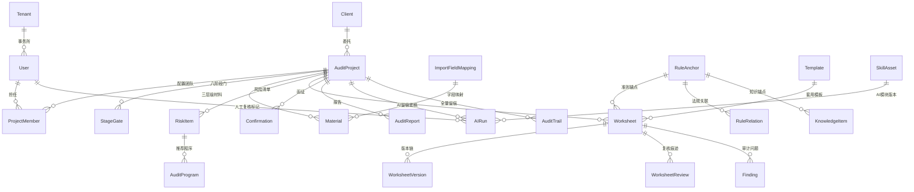

# Echo 审计作业平台 技术设计文档（TECH_DESIGN）v1.1

> 产品：Echo —— 中小事务所智能审计作业系统 ｜ 形态：Skill 家族 + Web 平台 ｜ 面向广大中小型会计师事务所
> 依据：《Echo——中小事务所智能审计作业系统产品需求文档（PRD）v1.2》（§1–§16：FR-01～07、NFS-01～05、共享规则 R1–R8、核心对象与状态 §4、决策记录 17 项 §15）
> 版本：v1.1 ｜ 2026-10-27 ｜ 修订说明：v1.0 基于 PRD v1.0 编制；本版对齐 PRD v1.2，落实 §15 全部 17 项决策，修正状态机与留痕字段口径，补充分期交付映射、接口域清单、测试策略与变更管理。技术选型结论不变。

---

## 〇、设计总纲（与 PRD 的对齐逻辑）

PRD 四条硬约束决定本方案的总体形态：

1. **数据不出域（NFS-01、红线 4/5、§7 R4）** → 平台以**单所私有化部署**为默认形态，全套组件支持全离线安装；托管形态仅承载脱敏后的 Skill 与模板资产，永不承载客户数据；核心级数据禁用一切云端通道（含 Skill 资产库出站同步）。
2. **Excel 底稿即界面（PRD §12）** → Web 端是"薄前端"，只承载命令面板、项目看板、复核队列、质控驾驶舱、知识库问答六个界面模块；底稿本身始终是 Excel 文件，由后端 openpyxl 引擎读写，前端不渲染底稿内容。
3. **AI 输出=线索→复核→证据（PRD §7 R2、§4.6）** → AI 能力全部走后端统一管道，产出必经人工复核标记落库，前端只消费管道终态。
4. **去品牌化（PRD §15-1）** → 方法论骨架以「八阶段风险导向框架」自有提炼表述；代码、模板、知识库不内置任何外部机构受版权内容；对外交付物不含外部机构来源表述。

**五层架构**（本方案定义，承接 PRD §13 产品形态）：入口层 = Web 前端 + 统一入口（audit-hub）；AI 层 = `ai/` 模块；引擎层 = `services/` + `engine/`；模板层 = `templates/` 行业模板矩阵；准则层 = `RuleAnchor` 准则映射总表库。映射关系见 §2。

**分期总叙事**：PRD §10 要求 Phase 2 的 AI 模块"在现有运行环境零新增依赖前提下跑通"。因此核心算法（风险评估、全量异常评分）为**纯 Python 零第三方依赖**实现，先以 Skill zip 形态交付并跑通 Phase 2 验收；Web 平台组件（PG/Redis/本地对象存储/Celery）作为 P0 卡控能力的承载面在 Phase 2 中后期引入，Phase 3 完成双项目实战。详见 §5 分期交付映射。

---

## 一、技术栈选型

### 1.1 总览

| 层 | 选型 | 版本基线 | 引入时点 |
| --- | --- | --- | --- |
| 前端框架 | Vue 3 + TypeScript + Element Plus + Vite + Pinia | Vue 3.4+ | Phase 2 中后期 |
| 后端框架 | Python FastAPI + SQLAlchemy 2.0 + Pydantic v2 | Python 3.13 | Phase 2 中后期 |
| 主数据库 | PostgreSQL 16（含 pgvector 扩展） | PG 16+ | Phase 2 中后期 |
| 缓存/队列 | Redis 7（会话、发布订阅、Celery broker） | Redis 7+ | Phase 2 中后期 |
| 对象存储 | 本地文件系统卷（底稿、凭证影像等原始文件） | 单机命名卷 | Phase 2 中后期 |
| 异步任务 | Celery（大文件解析、全量异常评分、附注生成）+ Celery Beat（函证超期定时提醒） | — | Phase 2 中后期 |
| Excel 引擎 | openpyxl 3.1.5 + xlrd（与 PRD NFS-04 一致，不引入 LibreOffice） | — | Phase 1 起既有 |
| 核心算法 | 纯 Python 实现（孤立森林/本福特定律/规则引擎，零第三方依赖，PRD §10 Phase 2 验收口径） | — | Phase 1–2 |
| AI 推理 | 本地 Python 分析 + 私有化大模型 vLLM（**默认关闭，三条件启用**，见 1.5） | — | Phase 3 |
| 部署 | Docker Compose 一键离线安装包（web / api / worker / beat / pg / redis 六容器） | — | Phase 2 中后期 |

### 1.2 前端：Vue 3 + TypeScript + Element Plus

**选型理由**：

- **中文生态与维护成本**：平台面向中小所实施与二次维护，Vue + Element Plus 的中文文档、社区案例、组件示例最全，中小团队招人和交接成本最低——支撑 PRD NFS-03"零编程中文界面、免培训完成首张底稿并提交复核"的间接保障（实施人员也容易上手）。
- **表格密集场景成熟度**：平台界面 = 看板 + 队列 + 仪表盘 + 清单（PRD §12 六个界面模块），Element Plus 的 Table/Form/Timeline/Steps 组件与八阶段门进度条、复核留痕时间线、函证台账等场景一一对应，无需自研组件。
- **轻量与渐进**：Vite 构建秒级热更，Pinia 状态管理直观；前端刻意做"薄"——不渲染底稿内容、不做复杂画布，包体小、老办公电脑也能流畅跑（中小所硬件现实）。

### 1.3 后端：Python FastAPI

**选型理由**：

- **与现有 Skill 家族同语言（决定性因素）**：现有 Skill 家族为 Python 3.13 + openpyxl 栈（数量口径见 1.5，受控 zip 包计数）。后端选 Python，则三层级材料投喂、底稿引擎、六大 AI 模块（`ai_risk` / `ai_anomaly` / `ai_confirm` / `ai_notes` / `ai_qc` / `rag`）的核心代码与 Skill 家族**同栈复用**，不产生跨语言桥接成本；Skill 升级即后端引擎升级。
- **并发能力足够**：FastAPI 基于 uvicorn/ASGI 异步，单所并发量级（执业高峰数十至数百在线用户，PRD 客群为中小所）远在其承载范围内；重活全部下沉 Celery worker 横向扩展，Web 进程保持轻载——对应 NFS-02 性能指标。
- **安全与契约**：Pydantic 强类型出入参校验（防注入的第一道门）、自动 OpenAPI 文档（接口即文档，降低维护成本）、OAuth2/JWT 标准组件化。
- **易于维护部署**：单语言栈 = 单依赖清单 = 单镜像；配合 Docker Compose，一所一套，`docker compose up -d` 完成部署。

### 1.4 数据库：PostgreSQL 16 + pgvector + Redis + 本地对象存储

**选型理由**：

- **PostgreSQL（主库）**：
  - **数据安全**：成熟行级安全（RLS）策略天然支撑"项目内只读/全所调阅"等 PRD §3 权限矩阵的库端兜底；TLS 连接、静态加密、细粒度备份（按库/按表）齐备；
  - **半结构化支撑**：底稿元数据、AI 输出、风险清单字段弹性大，JSONB 列承载动态字段，避免频繁 DDL；
  - **一库两用**：pgvector 扩展直接做向量检索（资料预解析入向量库，PRD FR-01-04/FR-07-01），**不额外引入独立向量库**，中小所运维面最小化；
  - **知识图谱承载**：法规关联以邻接表（`RuleRelation`，见 §3.2）存储于 PG，支撑 FR-07-02 图谱路由，不引入图数据库；
  - **审计友好**：触发器与逻辑复制可做 append-only 留痕兜底，与哈希链双保险（见 4.3）。
- **Redis**：会话、接口幂等锁、底稿编辑乐观锁版本号、Celery broker、SSE 进度推送的发布订阅。**不落任何客户业务数据**，纯易失态。
- **本地对象存储**：原始资料包、底稿文件、函证扫描件以本地文件系统卷持久化（Docker `objects_data` 命名卷挂 `/srv/data/objects`），不引入 MinIO——其开源版已归档停止维护（dl.min.io 返回 410 Gone，Docker Hub 镜像被拒），且中小所单台物理机部署不需要分布式对象存储。静态加密靠 OS 层（LUKS/BitLocker 加密卷）；归档不可变（WORM）靠 Linux `chattr +a`（append-only）实现，差错修订走副本机制 v(n+1)，原稿锁定保留；文件路径不入库明文，入库的是带密钥派生的对象键。
- **多所形态兼容**：所有业务表携带 `tenant_id`（=事务所），默认单所部署时恒为常量；未来区域托管形态按 tenant 分桶+RLS 隔离，数据模型不返工。
- **排除项**：MySQL（JSONB/RLS/pgvector 三项均弱）；MongoDB（事务与关联查询弱，审计场景吃亏）；独立向量库（增加运维面，中小所养不起 DBA）；独立图数据库（法规关联规模小，邻接表足够）。

### 1.5 算力与大模型通道（落实 PRD §15-14/15）

- **算力路线：先租后买**。Phase 1–2 纯本地 Python 分析零 GPU 需求；Phase 3 试跑租用 4090 双卡机（约 2 万/年，估算值）承载 vLLM 私有化推理；连续 3 个月租金不低于自购折旧时启动自购评估（自购 30–50 万、硬件周期 3–4 年，均为估算值）。
- **大模型通道：默认关闭，条件启用**。vLLM 通道在配置层默认 `disabled`；仅当以下三项**同时满足**时方可开启：①本地规则/统计推理不可行（如附注生成等生成式任务）；②目标数据为"一般"级且完成脱敏（§4.2.3）；③供应商保密评估通过并留档。任一条件失效自动回落本地推理。
- **Skill 数量口径（PRD §15-13）**：以受控 zip 包数计——存量 16 个 = 2 底座 + 5 阶段 + 9 循环（统一入口 audit-hub 属 9 循环之一）；Phase 2 新增 5 个 AI shell 后合计 21 个；完整清单随技术方案维护为受控附件，本文档只锁计数口径。

---

## 二、项目结构

### 2.1 仓库组织（monorepo）

```
echo-audit/
├── frontend/                        # Vue 3 前端（薄前端）
│   ├── src/
│   │   ├── api/                     # 按后端路由域分文件：project.ts worksheet.ts review.ts ...
│   │   ├── views/                   # 严格对应 PRD §12 六个界面模块
│   │   │   ├── hub/                 # 统一入口 audit-hub 命令面板
│   │   │   ├── project/             # 项目工作台（看板：阶段门/风险/问题/函证/工时）
│   │   │   ├── worksheet/           # 底稿工作台（三层级材料投喂区 + AI 侧栏 + 准则锚点）
│   │   │   ├── review/              # 复核工作台（队列 + 意见流 + 双签 + 留痕时间线）
│   │   │   ├── quality/             # 质控驾驶舱（健康度/卡控告警/AI留痕抽查）
│   │   │   └── knowledge/           # 知识库问答（RAG 对话窗，答案带准则锚点引用）
│   │   ├── components/              # StageGateSteps / ReviewMark / AnchorTag 等公共组件
│   │   ├── stores/                  # Pinia：session / project / worksheet
│   │   ├── router/                  # 路由守卫做前端权限兜底（后端为准）
│   │   └── utils/
│   └── vite.config.ts
│
├── backend/                         # FastAPI 后端
│   ├── app/
│   │   ├── api/v1/                  # 路由层（薄）：auth projects materials worksheets reviews
│   │   │                            #   confirmations findings knowledge quality ai admin
│   │   ├── core/                    # config / security(JWT+权限码RBAC) / audit_middleware(留痕切面)
│   │   ├── models/                  # SQLAlchemy ORM（第三章数据模型）
│   │   ├── schemas/                 # Pydantic DTO
│   │   ├── services/                # 业务逻辑层（厚），模块划分=PRD 七大 FR 域
│   │   │   ├── intake/              # FR-01：立项、命名引擎(R6)、资料自动分类、清单缺口
│   │   │   ├── planning/            # FR-02：计划、重要性水平(R8)、风险评估流程、模板选择、工时对比
│   │   │   ├── worksheet/           # FR-03：三层级材料投喂(策略模式)、底稿引擎、交叉索引(R7)
│   │   │   ├── confirmation/        # FR-04：函证台账、回函核对、替代测试、快递适配器
│   │   │   ├── review_flow/         # FR-05：双签(R1)、复核痕迹、附注出稿、签发审批、意见分歧
│   │   │   ├── quality/             # FR-06：阶段门卡控(R3)、质控检查、归档包、差错处理
│   │   │   └── knowledge/           # FR-07：准则RAG、知识图谱、Skill资产、知识入库审批、经验回流
│   │   ├── engine/                  # 全局规则引擎：八阶段门状态机 / 底稿·函证·问题状态机 / 风险分级程序包(R5) / 重要性水平计算(R8)
│   │   ├── ai/                      # 六大 AI 模块（每个=输入校验+推理+留痕三段式）
│   │   │   ├── pipeline.py          # 线索→复核→证据 统一管道（含复核标记门禁）
│   │   │   ├── ai_risk.py  ai_anomaly.py  ai_confirm.py
│   │   │   ├── ai_notes.py  ai_qc.py  rag.py
│   │   ├── workers/                 # Celery 任务：parse_large_file / anomaly_scoring / confirm_overdue(Beat)
│   │   ├── integrations/            # 外部适配器：sf_express.py（顺丰，预留标准接口可扩展 EMS）
│   │   └── main.py
│   ├── alembic/                     # 数据库迁移（版本化，对应 NFS-05 可回滚）
│   ├── templates/                   # 行业模板矩阵 + 准则映射总表（数据即代码，随版本发布）
│   ├── mapping/                     # 字段映射模板（非标明细账→标准字段，PRD §15-6）
│   ├── skills/                      # Skill 家族（audit-*/ai-*，存量16+新增5=21），build_audit_zips.py 打包
│   └── tests/
│
├── deploy/
│   ├── docker-compose.yml           # web / api / worker / beat / pg / redis 六容器
│   ├── offline-installer/           # 全离线一键安装（镜像 tar 包 + 初始化脚本）
│   └── backup/                      # pg_dump + 对象存储卷打包的定时备份脚本（RPO≤24h，恢复演练脚本同交付）
└── docs/
```

### 2.2 模块划分逻辑

1. **路由层薄、服务层厚**：api/v1 只做鉴权与出入参；所有业务规则在 services，保证留痕切面和权限策略集中生效。
2. **services 按 PRD 七大 FR 域切分**：一个 FR 域一个包，包内再分引擎与流程，FR 编号与代码目录可互相直查（评审、验收、回归都按 FR 走，对应 PRD §10 验收标准）。
3. **engine 独立于 services**：阶段门状态机、三个业务对象状态机（底稿/函证/问题）与风险分级、重要性水平规则是全局规则（PRD §4、§7 的系统化），不隶属于任何单一 FR，任何 service 调用状态流转必须过 engine，防止绕过卡控。
4. **ai/ 与 services 分离**：AI 模块只产出"线索"（lead），不允许直接写业务表——统一经 pipeline 在人工复核标记后落 evidence，架构上强制 PRD 红线 1 与 §7 R2。AI 模块按数字员工分层（PRD §15-4）约束输出权限：助理级输出（资料整理、初稿、抽凭清单执行辅助）与经理级输出（完整性检查、缺口提示）分别注册，副经理/合伙人级无 AI 输出，仅汇总视图。
5. **integrations 适配器制**：外部接口（顺丰快递等）统一走适配器，出站白名单校验（§4.2.6），首期仅顺丰，预留 `ExpressAdapter` 标准接口可扩展 EMS（PRD §15-9）。
6. **templates/、mapping/ 数据即代码**：模板矩阵、准则锚点映射表、字段映射模板随代码版本发布（zip 版本化管理），与 build_audit_zips.py 分发链一致。

### 2.3 接口域清单（REST，/api/v1）

| 域 | 路由前缀 | 核心职责 | 主要消费方 |
| --- | --- | --- | --- |
| 认证 | /auth | 登录、JWT、会话 | 全部 |
| 项目 | /projects | 立项审批、阶段门流转、暂停/终止、看板聚合 | 项目工作台 |
| 资料 | /materials | 上传、三层级登记、缺口清单、字段映射 | 底稿工作台 |
| 底稿 | /worksheets | 底稿 CRUD、AI 初稿、版本链、交叉索引 | 底稿工作台 |
| 复核 | /reviews | 提交/接单/退回/双签、复核时间线 | 复核工作台 |
| 函证 | /confirmations | 台账、发出登记、物流回写、回函核对、替代程序 | 项目工作台 |
| 问题 | /findings | 归集、确认、处理、升级裁决 | 项目工作台 |
| 知识 | /knowledge | RAG 问答、知识入库审批、图谱查询、Skill 管理 | 知识库问答 |
| 质控 | /quality | 质控检查、AI 留痕抽查、归档包、检查应对 | 质控驾驶舱 |
| AI | /ai | 各 AI 模块触发与留痕查询 | 各工作台 AI 侧栏 |
| 管理 | /admin | 用户、权限码、模板/Skill 发布、备份 | 管理员 |

接口契约：出入参一律 Pydantic Schema；状态变更类接口幂等（请求 ID + Redis 锁）；错误码按域分段（如 WS-1xxx 底稿域）。

---

## 三、数据模型

### 3.1 核心实体与关系（ER 概览）



### 3.2 实体定义（核心字段）

状态枚举与 PRD §4 状态机严格一致，流转由 `engine/` 统一裁决，services 不得自行改状态。

**用户与权限（PRD §3 角色权限矩阵）**

- `User`：id、tenant_id、姓名、登录名、密码哈希（argon2）、全局角色（合伙人/项目经理/审计员/质控专员）、执业证书号、状态。全局角色决定菜单与功能面。
- `ProjectMember`：project_id、user_id、**项目角色**（编制/复核/查看）。双层权限=全局角色∩项目角色，再叠加权限码（§4.2.2 覆盖 PRD 矩阵 10 个权限动作）；编制与复核不得同一人（库端 CHECK + 服务端双验，对应 FR-05-01、§7 R1）。

**客户与项目**

- `Client`：id、tenant_id、名称、统一社会信用代码、行业、**数据等级**（核心/重要/一般，财政部三级，驱动脱敏与上云管控，PRD §7 R4、NFS-01）。
- `AuditProject`：id、tenant_id、**项目编号**（命名引擎种子，FR-01-02）、名称、client_id、业务类型（一般企业年报/小企业准则/事业单位/房地产/建安/商贸/科技型中小企业/非上市/专项/经责）、template_id、当前阶段（八阶段枚举，§4.2）、**项目状态（进行中/暂停/已归档/终止）**、期间、立项评价结论（JSONB）。
  - **暂停**：合伙人批准后阶段门冻结、项目内禁止一切写操作（engine 拒绝非只读事务）；恢复从冻结门继续；超 12 个月系统提示转归档或终止（PRD §15-17）。
  - **终止**：合伙人审批后触发质控封存「终止归档包」（资料+底稿+留痕+终止原因），不纳入常规归档考核，可复用经验仍走知识回流（FR-07-04）。

**阶段门（FR-06-03、PRD §4.2）**

- `StageGate`：project_id、阶段（承接→计划→风险评估→内控→实质性→完成→报告→归档）、状态（未开始/进行中/已通过/跳过）、通过条件快照（JSONB，按 §4.2 八门准入条件生成）、通过人、通过时间。**跳过**必须同时登记合伙人与质控双批记录（§7 R3）。

**三层级材料（FR-03-01、§15-6）**

- `Material`：project_id、层级（customer 客户层 / firm 事务所层 / rule 填表说明层）、文件对象键、解析状态、向量库引用、缺口标志。**资料不齐=存在缺口标志的必需材料未到位，底稿引擎拒绝出稿**（策略模式的拦截点，PRD"不出半成品"）。
- `ImportFieldMapping`：客户/来源系统、源字段名→标准字段映射（JSONB）、映射人、复用范围。解析前先跑**最低字段校验**：科目余额表须含科目编码/名称/期初/借方/贷方/期末且级次≥3；明细账须含日期、凭证号、摘要、科目编码、科目名称、借方、贷方（对方科目可选）；非标格式走映射模板人工映射一次、同客户复用；低于最低要求按资料缺口提示（PRD §15-6）。

**风险与程序（FR-02、§7 R5/R8）**

- `RiskItem`：project_id、来源（ai 风险评估/人工）、财报层风险描述、认定层次映射、风险等级、状态（待确认/已确认/已应对）。项目经理逐项确认或修改，修改记入留痕（§5.2 行为链）。
- `AuditProgram`：risk_id、程序代码、程序包类型（**高风险全程序/低风险简化程序包**，简化包必带准则最低底线标注，§7 R5）、关联 worksheet 需求、执行状态。
- `Materiality`（重要性水平，PRD §7 R8）：project_id、基准类型（营业收入/费用总额/总资产）、基准金额、比例、整体重要性、实际执行比例（默认 60%，区间 50%–75%）、明显微小比例（默认 5%）、修改留痕（JSONB）。默认值按主体类型预置：盈利主体=营业收入×0.5%、成本费用化=费用总额×1%、资产基础型=总资产×0.5%；项目经理可改，随审计计划一并报合伙人审批确认。

**工作底稿（FR-03、FR-05、PRD §4.3）**

- `Worksheet`：project_id、底稿编号、标题、template_id、**rule_anchor_id（准则锚点：准则号+条款+程序目的，不可空外键）**、当前版本号、**状态（草稿/待复核/复核中/复核通过/终审通过/已归档）**、文件对象键、交叉索引引用（JSONB 数组，供质控 AI 断链校验）。
  - 状态流转对齐 PRD §4.3 状态机：草稿→待复核（提交，AI 内容须已完成复核标记 §7 R2）→复核中→复核通过（复核人接单后裁决，退回必附意见回到草稿）→**终审通过**（仅重要底稿）→已归档（随项目归档）。
  - **重要底稿判定清单**（触发终审，PRD §15-11）：审计报告与附注、总体策略与重要性水平底稿、风险评估总表、关键审计事项底稿、含调整分录的底稿、货币资金/收入/关联方底稿、意见分歧涉及的底稿。
- `WorksheetVersion`：worksheet_id、版本号、文件对象键、变更摘要、编制人、时间。**版本链而非覆盖写**，归档后不可变。
- `WorksheetReview`：worksheet_id、version_id、复核轮次、复核人、复核意见、修订要求、**电子签名（复核人+日期+证书号）**、结论（通过/退回）。全部轮次留痕可追溯（FR-05-02）。

**函证（FR-04、PRD §4.4）**

- `Confirmation`：project_id、类型（银行/往来）、对方单位、函证金额、**状态（台账已生成/已发出/已回函/超期未回/核对一致/差异处理/替代程序/闭环）**、发出时间、计划回函日期、快递单号（适配器回写）、物流状态、回函差异（JSONB）、替代测试记录、提醒计数。
  - 状态流转对齐 PRD §4.4 状态机；**超期机制**：发出后 30 天未回函自动转「超期未回」，此后每 15 天提醒一次（Celery Beat 定时任务），累计两次提醒后系统建议启动替代程序；全部函证「闭环」是实质性阶段门准入条件之一（PRD §4.2 门 5）。

**审计问题与报告（FR-03-06 / FR-05、PRD §4.5）**

- `Finding`：project_id、worksheet_id、问题描述（如经营范围与实际销售不符）、来源（AI 归集/人工）、**状态（已归集/已确认/处理中/已解决/已关闭/已排除）**、责任项目经理、分歧裁决引用。
  - 流转对齐 PRD §4.5：AI 归集默认「已归集」；项目经理误报可标记「已排除」并留痕理由；涉及报告意见类型的升级合伙人裁决（FR-05-05），裁决前不得关闭。
- `AuditReport`：project_id、版本、附注草稿对象键（附注 AI 产出+人工修订记录）、状态（草稿/会签/已签发）、签发合伙人、签发时间。

**留痕（红线 1/3、FR-06-02、PRD §4.6）**

- `AuditTrail`（全量操作留痕）：tenant_id、实体类型、实体 id、动作、操作人、变更前后快照（JSONB）、**前条哈希+本条哈希（哈希链）**、时间。append-only，无 UPDATE/DELETE 权限。
- `AIRun`（AI 使用留痕，字段对齐 PRD §4.6）：**留痕编号（全局唯一）**、project_id、触发人、触发时间、AI 模块与 Skill 版本、输入材料清单（Material 外键数组+输入哈希）、**输出摘要与输出对象键**、复核人、复核日期、采信结论（采信/部分采信/不采信+理由）、**关联对象（类型+id：底稿/函证/问题）**。
  - 不采信结论必附原因分类（事实错误/口径错误/幻觉/其他，PRD §15-16）；归档时系统自动汇总脱敏错误样例随经验回流提案进入知识库，质控按季度分析。

**模板与知识资产（FR-07、PRD §15-1/3/13）**

- `Template`：行业模板矩阵（类型、版本、底稿骨架、程序包默认映射）。
- `RuleAnchor`：准则号、条款、程序目的（准则映射总表的库化，PRD Phase 1 交付物的运行态）。
- `RuleRelation`：rule_from、rule_to、关系类型（上下位/引用/关联）、图谱版本（FR-07-02 知识图谱的邻接表存储，路径固定防幻觉）。
- `KnowledgeItem`：类型（**准则/应用指南/监管规定/中注协底稿指南/本所沉淀经验**；不内置外部机构受版权内容，PRD §15-1）、内容、向量引用、关联 RuleAnchor、来源项目（经验回流，FR-07-04）、**状态（提案/质控审核中/待合伙人批准/已发布/已驳回）**、提案人、审核人（质控）、批准人（合伙人）、驳回理由。入库链=提案/提交→质控审核→合伙人批准发布；质控专员直接写入免自审，合伙人保留驳回权（PRD §15-3）。
- `SkillAsset`：Skill 名称（audit-*/ai-*）、版本、zip 对象键、审核状态（待审核/已发布/已下线）、审核人、批准人、静态扫描结果（禁含 IP/路径/凭证）、回滚版本链（FR-07-03；数量口径 §1.5）。

### 3.3 关系要点

1. **Worksheet ↔ RuleAnchor 强制外键**：底稿必带准则锚点（不可空），库端保证"这条程序依据哪条准则"100% 可反查（红线 2）。
2. **AIRun 不直接关联业务结论**：只关联 Material、关联对象索引与复核人；采信后的结论写入 Worksheet/Finding，中间靠人工复核标记衔接——物理上隔开"AI 说的"与"人认的"（红线 1）。
3. **AuditTrail 独立于业务表**：业务表可演进，留痕表结构冻结（哈希链要求），两者经实体类型+id 弱关联。
4. **tenant_id 全表贯通**：单所部署为常量，托管形态启用 RLS 按租户隔离。

---

## 四、关键技术点与应对思路

### 4.1 大文件与全量数据处理（NFS-02）

**难点**：客户资料包（扫描件混合 Excel）、千万行级明细账与凭证流水；PRD 要求 10 年份量级历史底稿分析 ≤2 小时、100% 凭证异常评分（FR-03-04）。

**应对**：

1. **流式解析**：openpyxl `read_only=True` + xlrd 按行流式读取，内存 O(1)；大 CSV 用 pandas chunksize 分块。
2. **最低字段校验与字段映射**（PRD §15-6）：解析前校验 §3.2 最低字段要求，非标格式走 `mapping/` 字段映射模板人工映射一次、同客户复用；低于要求按资料缺口提示，不进入解析队列。
3. **中间列存层**：原始 Excel 一次性解析为 Parquet 列存（按项目/科目分区），后续异常评分、风险评估、附注生成全部读 Parquet，不反复解析 Excel——"预解析入向量库压缩调用时间"的结构化版本。
4. **异步化**：解析与评分全部走 Celery worker，Web 进程零阻塞；SSE 推送进度到前端（对应 PRD §12 任务态）。
5. **增量评分**：凭证按月分区，新增数据增量打分，历史结果缓存；孤立森林/本福特定律为纯 Python 零依赖实现（PRD §10 Phase 2 验收口径）。
6. **分批与降级**：超大凭证量自动分批（PRD §14 边界场景），单批失败不影响已评批次，断点续跑。

**性能指标技术保障对照**：

| NFS-02 指标 | 技术保障 |
| --- | --- |
| 6 份文档 30 分钟内分类归档 | 解析队列优先级 + 多 worker 并行 + 识别置信度阈值减少人工确认 |
| 10 年份量级历史底稿分析 ≤2 小时 | Parquet 列存 + 分区裁剪 + 增量评分 |
| 单张底稿 AI 初稿分钟级 | 模板结构预载入 + 取数 Parquet 化 + 填写约束白名单缩小推理面 |

### 4.2 数据安全与权限控制（NFS-01、红线 4/5、§7 R4）

**难点**：客户数据不出域；财政部核心/重要/一般三级管控；Skill 上云而数据留本地的两端密钥；编制/复核职责分离。

**应对**：

1. **纵深防御四层**：JWT 认证 → 全局角色（菜单/路由）→ 项目角色（数据行过滤，服务层强制注入 `project_id` 条件）→ PostgreSQL RLS 库端兜底。任何一层失守，下一层仍拦截。
2. **权限码覆盖 PRD 矩阵 10 项动作**：`project.approve`（立项/终止审批）、`plan.confirm`（审计计划确认）、`worksheet.edit`（编制）、`worksheet.review_sign`（复核/终审签发）、`ai_output.confirm`（AI 采信确认）、`finding.handle`（问题处理）、`report.sign`（报告签发/会签）、`skill.publish`（Skill/模板发布）、`knowledge.write`（知识库写入/审核）、`archive.access`（归档调阅）。权限码-角色矩阵配置化（`core/permissions.py`），与 PRD §3 矩阵逐项对应并有测试覆盖（§7.3）。
3. **职责分离的机器可验**：ProjectMember 上"编制人与复核人不得同一 User"由库约束+服务校验双重保证，双签缺一即阶段门锁死（FR-05-01、§7 R1）。
4. **数据分级驱动管控**：Client.data_level 为策略开关——核心级：禁用一切导出接口与**一切云端通道（含 Skill 资产库出站同步）**、AI 推理强制本地模型、对象存储独立加密桶；重要级：导出走审批留痕；一般级：常规管控。脱敏在服务层统一切面完成，不由各模块自行实现。
5. **Skill 与数据分离（两端密钥碰合，FR-07-05）**：Skill 包（无数据、无局域网路径）可上云端资产库；运行时本地密钥 A + 云端密钥 B 派生会话密钥拉取，任一端撤销即失效。Skill 内容静态扫描禁止出现 IP/路径/凭证，违规在构建期拦截。
6. **静态与传输安全**：对象存储加密卷（LUKS/BitLocker）+ PG TDE 可选、全链路 TLS；备份加密后落本地 NAS（RPO≤24h），备份与恢复演练脚本随部署包交付。
7. **部署隔离与出站白名单**：默认单所 Docker Compose 私有化，全离线安装；平台任何云端通道（Skill 资产库、模板更新、顺丰 API）只出不进客户数据，出站白名单制；顺丰适配器仅传输函证收件人、单号、物流状态等必要字段，函证金额等审计数据不出站。

### 4.3 审计留痕与不可篡改（红线 1/3、FR-06-02、PRD §4.6/§15-16）

**难点**：AI 使用过程、复核痕迹、阶段门流转必须全程留痕且经得起检查；归档后差错必须可修且不可抹史。

**应对**：

1. **统一留痕切面**：core/audit_middleware 在服务层统一拦截写操作，自动生成 AuditTrail——业务开发者无法绕过（想不留痕得改框架代码，代码评审红线）。
2. **append-only + 哈希链**：AuditTrail 每条含前条哈希，链尾每日锚定快照；任何历史篡改都会断链，检查时可整链验证。数据库层面回收 UPDATE/DELETE 权限。
3. **AI 留痕三段式**（ai/pipeline.py 强制，字段对齐 PRD §4.6）：输入（材料清单+哈希）→ 推理（模块与模型版本+输出摘要与文件）→ 人工复核标记（复核人+日期+采信结论）——第三段未落库，输出永远停在"线索"态，无法进入 WorksheetVersion 版本链，也就无法归档（§7 R2 的实现形态）。
4. **归档不可变 + 差错 v(n+1) 双版本**（PRD §15-16）：归档包一次性打包并记录整包哈希，对象存储开版本锁（WORM 语义），归档包只读。归档后差错：质控专员登记→合伙人批准→解锁受影响底稿**副本**修订（原稿锁定保留）→质控复核→重新归档生成 v(n+1) 归档包，新旧包整包哈希均留痕可查。
5. **AI 错误回流**：复核人"不采信"结论必附原因分类（事实错误/口径错误/幻觉/其他）；归档时系统自动汇总脱敏错误样例随经验回流提案（FR-07-04）进入知识库，质控按季度分析。
6. **检查应对视图**：质控驾驶舱直接按 Worksheet→RuleAnchor→AuditTrail 三联查询出证（FR-06-05 准则锚点反查的落地面）。

### 4.4 Excel 模板保真与底稿引擎（FR-03-02/03-05、NFS-04、§7 R6/R7）

**难点**：底稿初稿"公式不改、下拉框不发挥"；严格遵循现有模板不自创格式；多人协作不互相覆盖；AI 不得编造。

**应对**：

1. **保真写回**：openpyxl 打开模板 → 仅写数据单元格 → 公式区、数据验证（下拉框）、样式零触碰；写回前后对模板做**结构指纹校验**（公式区哈希+验证规则清单比对），指纹变化即拒绝保存——"不自创格式"从约定变成机器校验。
2. **填表说明的结构化**：第三层 rule 材料解析为机器可读约束（单元格白名单、枚举值），AI 填写与人工修订同受约束。
3. **AI 置空机制**（FR-03-02）：AI 无法可靠生成的单元格标注"AI 未能生成"并置空提示人工，禁止编造；置空清单随 AI 留痕输出摘要记录，供复核人聚焦。
4. **乐观锁协作**：Worksheet 版本号 + Redis 锁；两人同时改同一底稿，后提交者收到版本冲突并看到差异，不静默覆盖。
5. **命名引擎**（FR-01-03、§7 R6）：按"项目编号+委托方+年份+类别"规则自动重命名，类别简称枚举（CJ/JH/FX/NK/DG/HZ/BG/ZK/GD/QT）配置化；命名由系统执行，人工不可改写。
6. **交叉索引生成器**（§7 R7）：底稿引用关系由引擎从标注解析生成（FR-03-05），**保存与归档两个时点强制断链校验**，质控 AI 断链校验消费同一数据源，避免两套口径。

### 4.5 AI 幻觉治理与准则 RAG（FR-07-01/02、§15-10）

**难点**：直接用大模型幻觉不可避免；知识库无关联时答案不稳定。

**应对**：

1. **强制引用作答**：RAG 问答必须返回准则锚点引用（RuleAnchor 外键），无引用不出答案；检索置信度低于阈值时明示"知识库未覆盖"（PRD §14 边界场景硬约定），不强行作答。
2. **知识图谱优先路由**：法规关联关系（`RuleRelation` 邻接表）先路由到关联法规簇，向量检索只在簇内召回——路径固定、弱点固定，从机制上压幻觉（FR-07-02）。
3. **AI 风险清单前置且配置化**（红线 6、PRD §15-10）：每个 ai_* 模块运行前逐条核对 10 项风险清单（保密泄露/数据篡改/幻觉输出/训练偏差/不可追溯/版本失控/过度依赖/权限越界/外部通道泄密/法规漂移），清单未过不推理；清单为配置资产，质控专员每年至少修订一次，ITC 评估触发即时修订，修订记录随版本发布留档。
4. **大模型三条件门禁**（§1.5）：vLLM 通道默认关闭，启用前管道自动校验三条件（生成式任务必要性+一般级脱敏数据+保密评估留档），任一不满足则拒绝启用并回落本地推理。

### 4.6 函证生命周期与外部集成（FR-04、PRD §4.4/§15-9）

1. **状态机驱动**：函证八状态流转由 engine 统一裁决（§3.2），差异处理/替代程序状态不阻塞底稿编制，但阻塞实质性阶段门。
2. **超期定时任务**：Celery Beat 每日扫描——发出满 30 天未回函自动转「超期未回」；每 15 天提醒一次，累计两次后出具替代程序建议（FR-04-04），全部动作留痕。
3. **顺丰适配器**（首期，PRD §15-9）：覆盖下单、轨迹、签收回传三个能力，回写 `Confirmation` 物流状态；实现 `ExpressAdapter` 标准接口（create_waybill / query_track / parse_callback），预留扩展 EMS。出站字段白名单见 4.2.7。
4. **回函核对**：回函扫描件 OCR 识别金额 → 与台账自动核对 → 一致转「闭环」、差异转「差异处理」，差异分析记录入 JSONB 留痕。

### 4.7 部署运维（NFS-05、面向中小所的现实）

1. **一键离线安装**：镜像 tar + docker compose + 初始化向导（建所、建管理员、导入模板包），目标 2 小时内完成一所部署，无需驻场 IT。
2. **版本化发布与回滚**：模板/Skill/代码同版本号发布，alembic 迁移可回滚；对应 build_audit_zips.py 的 zip 版本化管理传统；**ITC 评估记录随版本发布一并留档**（红线 6、NFS-05）。
3. **备份即交付**：每日 pg_dump + 对象存储卷打包到本地备份盘（RPO≤24h，RTO 目标≤4h）的脚本随部署包内置，恢复演练脚本同交付。
4. **资源弹性**：单所起步 8C16G 一台物理机即可（PG+Redis+本地对象存储+Web+API+Worker+Beat 全部容器化）；全量异常评分高峰可临时加 worker 容器横向扩。

---

## 五、分期交付映射（对齐 PRD §9/§10）

| 阶段 | 交付范围 | 技术形态 | 依赖约束 |
| --- | --- | --- | --- |
| Phase 1（1–2 周） | 准则映射总表库化（RuleAnchor）+ 行业模板库（templates/，以商洛鸿瑞怡园非上市模板为母本）+ 风险分级规则引擎（engine，§7 R5/R8） | 纯 Python + openpyxl，随 Skill zip 发布 | 零新增依赖 |
| Phase 2（2–3 周） | 先行：ai_risk + ai_anomaly 零新增依赖跑通（Phase 2 验收项）；随后 Web 平台核心承载 P0：立项/阶段门/底稿 AI/留痕归档/数据工具分离；再挂函证/附注/质控 | Skill 家族 → FastAPI 平台（PG/Redis/本地对象存储/Celery 引入） | AI 验收项零新增依赖；平台组件为 P0 承载面 |
| Phase 3（实战验证） | 双项目试跑（商洛鸿瑞怡园 2024 年报 + 鲲鹏物创 2025 底稿）、顺丰对接、P1 功能收口、私有化大模型（先租后买启动点） | 全栈 + integrations/sf_express | 出站白名单生效 |

优先级对应：P0 = Phase 1–2（骨架与卡控类）；P1 = Phase 2（提效类）；P2 = Phase 3 后视反馈排期（增强类）。FR 级优先级以 PRD §5 各表为准。

---

## 六、PRD 一致性对照（验收映射）

### 6.1 FR / NFS / 红线映射

| PRD 需求 | 技术落点 |
| --- | --- |
| FR-01-03 文件命名引擎 | intake 服务 + 类别枚举配置化（§7 R6） |
| FR-01-04 资料自动分类 | workers/parse + 向量库 |
| FR-02-01 重要性水平 | Materiality 实体 + engine 计算规则（§7 R8） |
| FR-02-02 风险评估 AI | ai/ai_risk + Parquet 中间层 |
| FR-03-01 三层级材料 | Material 三层级 + 策略模式拦截 + 最低字段校验（§15-6） |
| FR-03-02 底稿 AI 初稿 | worksheet 引擎 + 模板指纹校验 + AI 置空机制 |
| FR-03-03 准则锚点 | RuleAnchor 强制外键 |
| FR-03-04 全量异常 AI | ai/ai_anomaly + Celery 异步增量 + 阈值规则（§15-8） |
| FR-03-05 交叉索引 | 交叉索引生成器 + 保存/归档双时点校验（§7 R7） |
| FR-04-02 快递对接 | integrations/sf_express 适配器 + 出站白名单 |
| FR-04-03/04 回函与替代 | Confirmation 状态机 + Beat 超期任务 |
| FR-05-01 双签复核 | ProjectMember 库约束 + 权限码 + 阶段门锁（§7 R1） |
| FR-05-05 意见分歧 | Finding 分歧裁决引用 + 升级路径 |
| FR-06-02 AI 使用留痕 | AIRun 三段式管道（§4.6 字段） |
| FR-06-03 阶段门卡控 | engine 状态机独立模块（§4.2 八门准入） |
| FR-06-04 归档包 | WORM + 整包哈希 + 差错 v(n+1) |
| FR-07-01 准则 RAG | pgvector + 强制引用作答 |
| FR-07-02 知识图谱 | RuleRelation 邻接表 + 簇内召回 |
| FR-07-03 Skill 管理 | SkillAsset 版本链 + 静态扫描 |
| FR-07-05 数据工具分离 | 两端密钥碰合 + 出站白名单 |
| NFS-01 数据不出域 | 私有化部署 + 分级管控 + RLS + 核心级断云 |
| NFS-02 性能 | 流式解析 + Parquet + 异步队列（§4.1 对照表） |
| NFS-04 Excel 兼容 | openpyxl 保真写回 + 指纹校验 |
| 红线 1/2 AI 仅线索 | ai/pipeline 与 services 物理隔离 + 复核标记门禁 |
| 红线 7 双签卡控 | 库约束 + 阶段门状态机 |
| 红线 8 人担责 | 签发审批流 + 人工复核标记门禁 |

### 6.2 决策记录落实对照（PRD §15 全部 17 项）

| 决策 | 技术落点 |
| --- | --- |
| 1 PwC 去品牌化 | KnowledgeItem 类型重定义；交付物与代码不含外部机构来源（§3.2/§〇） |
| 2 工时基线与能力评估 | 项目工作台工时对比（偏差 10% 告警）；复盘/问卷为线下机制，平台出数 |
| 3 知识库审核链 | KnowledgeItem 五状态 + 质控审核/合伙人批准字段 |
| 4 数字员工映射 | ai/ 模块输出权限按助理/经理级注册，无高层级输出（§2.2.4） |
| 5 重要性水平 | Materiality 实体 + §7 R8 默认规则引擎 |
| 6 格式兼容底线 | ImportFieldMapping + 最低字段校验（§4.1.2） |
| 7 函证超期 | Confirmation 状态机 + Beat 30 天/15 天任务（§4.6.2） |
| 8 异常评分阈值 | 抽取规则配置化（Top10%∪单科5笔≥20笔，PM 可调下限 5%，调整留痕） |
| 9 函证快递 | sf_express 适配器 + ExpressAdapter 扩展接口（§4.6.3） |
| 10 AI 风险清单 | 10 项配置化清单 + 运行前校验 + 年度修订留档（§4.5.3） |
| 11 重要底稿清单 | 7 类判定清单驱动终审状态（§3.2 Worksheet） |
| 12 类别简称枚举 | 命名引擎枚举配置（§4.4.5） |
| 13 Skill 数量口径 | 存量 16+新增 5=21，zip 受控计数（§1.5） |
| 14 算力选型 | 先租后买路线（§1.5） |
| 15 大模型通道 | 默认关闭 + 三条件门禁（§1.5/§4.5.4） |
| 16 差错与 AI 错误回流 | v(n+1) 双版本归档 + 不采信原因分类回流（§4.3.4/5） |
| 17 终止/暂停 | AuditProject 状态机 + 阶段门冻结 + 终止归档包（§3.2） |

> 后续 PRD 变更须同步修订本文档 §6 两张映射表，流程见 §8。

---

## 七、测试与验收支撑

| 类别 | 范围 | 对应验收 |
| --- | --- | --- |
| 状态机单测 | 八阶段门准入（含跳过双批）、底稿/函证/问题状态机全流转与非法流转拦截 | FR-06-03、§4 |
| 模板指纹回归 | 全部行业模板写回前后指纹比对（公式区哈希+验证规则清单） | FR-03-02、NFS-04 |
| 权限矩阵测试 | 10 权限项 × 4 全局角色 × 3 项目角色的允许/拒绝断言，含编制=复核拒绝用例 | §3、§7 R1 |
| 留痕完整性 | 哈希链整链验证；AI 输出无复核标记不可归档的负向用例；差错 v(n+1) 双包哈希 | 红线 1/3、§15-16 |
| AI 门禁 | 风险清单 10 项前置校验；大模型三条件门禁；RAG 无引用不出答案 | 红线 6、§15-15 |
| 性能基准 | NFS-02 三指标压测（§4.1 对照表口径） | NFS-02 |
| 部署演练 | 离线安装 2 小时目标、备份恢复演练（RPO/RTO） | §4.7 |
| 函证联调 | 顺丰下单/轨迹/签收回写 mock 与沙箱联调；30 天超期与 15 天提醒时序测试 | FR-04、§15-7/9 |

---

## 八、变更管理

1. PRD 变更（含 §15 决策修订）→ 先改 PRD 并升版本号 → 同步修订本文档 §6 对照表与受影响章节 → 技术评审通过后发布；
2. 本文档与 PRD 版本联动：当前 PRD v1.2 ↔ 本文档 v1.1；PRD 升版而本文档未同步时，以 PRD 为准并在 §6 表头标注滞后状态；
3. 模板、Skill、字段映射等数据资产的变更走同一版本号发布链，回滚以 zip 版本为单位（NFS-05）。
